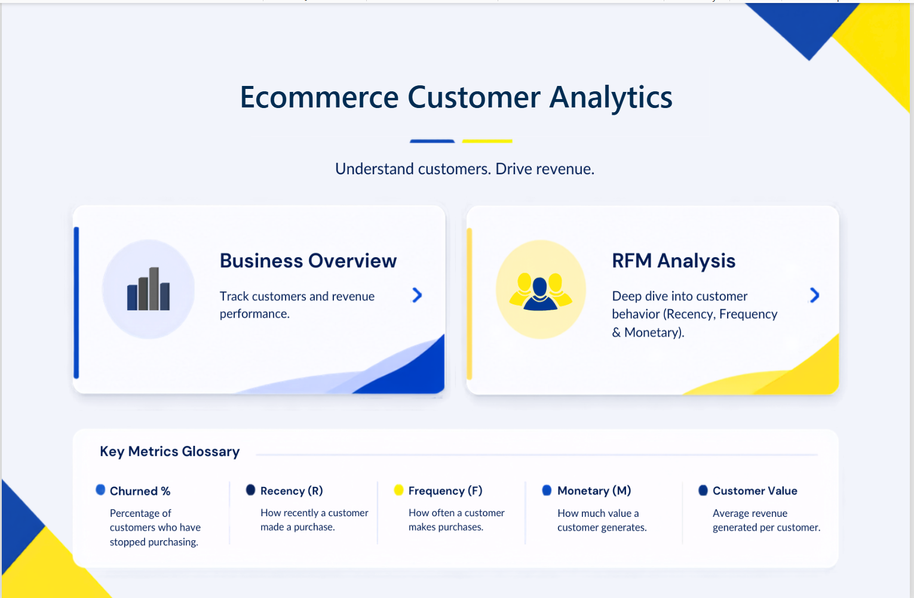
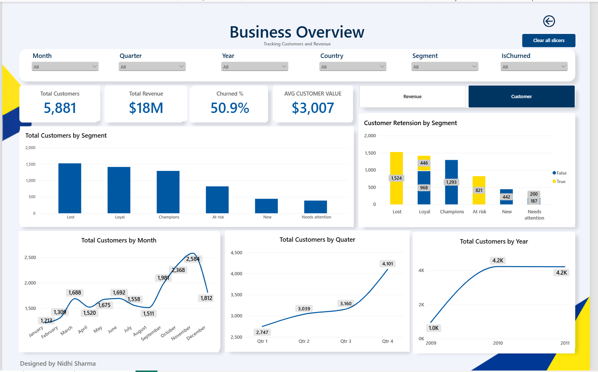
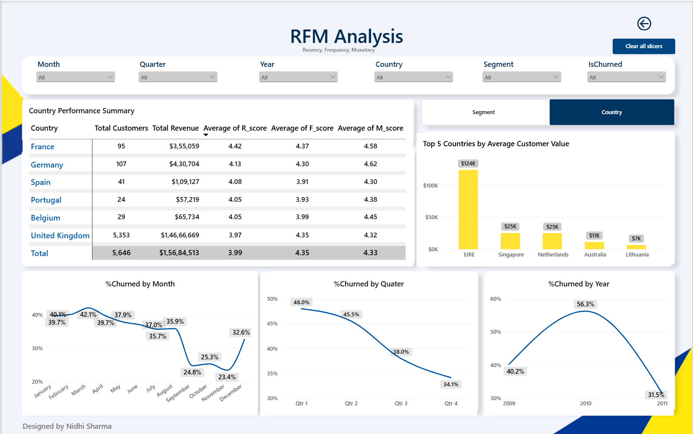

# E-Commerce Customer Analytics: RFM, Churn & Revenue

An end-to-end customer analytics project: raw transactions cleaned in **SQL Server**, customers segmented with **RFM in Python**, and the results presented in an interactive **Power BI** dashboard.

> **Business goal:** identify which customers drive the most revenue and which are drifting away, so marketing and CRM teams can target retention spend instead of treating every customer the same.



---

## Key findings

| Metric | Result |
|---|---|
| Customers analysed | **5,881** across 41 countries |
| Revenue | **£17.69M** (Dec 2009 – Dec 2011) |
| Average customer value | **£3,007** |
| Churn rate (no purchase in last 90 days) | **50.9%** |
| Champions | **22%** of customers generate **68.3%** of revenue |
| At-risk customers | **821** customers, **£1.62M** of past revenue, all currently inactive: the best win-back target |
| Lost customers | 1,524 customers (26%) but only 3.8% of revenue: low priority |
| Market concentration | United Kingdom = **82.9%** of revenue |

### Recommended actions by segment
- **Champions:** protect with loyalty perks and early access; do not discount.
- **Loyal:** upsell and cross-sell to move them toward Champions.
- **At risk:** run a win-back campaign now; they were high value and have just gone quiet.
- **New:** onboarding emails and a second-purchase incentive.
- **Needs attention:** low-cost reminders; test before investing more.
- **Lost:** low-cost reactivation only, with no heavy spend.

---

## Dashboard

| Page | What it shows |
|---|---|
| **Home** | Navigation to the two analysis pages and a glossary of key metrics |
| **Overview** | KPI cards (customers, revenue, churn %, avg customer value), with a toggle between Revenue and Customer views: segment, month, quarter and year trends |
| **RFM Analysis** | Segment performance table, average customer value by segment, and a toggle between Segment and Country views |




Features: slicers (month, quarter, year, country, segment, churn), bookmark-based view switching, a "Clear all slicers" button, and a custom JSON theme (`theme/`).

---

## Tech stack

- **SQL Server (SSMS):** combining the two yearly sheets, type conversion, data-quality checks, deduplication
- **Python (pandas):** RFM scoring, segmentation, churn flag, export for BI
- **Power BI:** data model, DAX measures, bookmarks, navigation, custom theme
- **Excel / CSV:** source and hand-off formats

---

## Pipeline

```
Online Retail II (2 Excel sheets, 1,067,371 rows)
        │
        ▼
SQL Server: union sheets → parse dates/prices → quality checks → remove exact duplicates
        │   (sql/01_data_cleaning_and_dedup.sql)
        ▼
RetailCleaned.csv
        │
        ▼
Python: filter valid customers/quantities → R, F, M → quintile scores → segments + churn flag
        │   (notebooks/RFM_segmentation.ipynb)
        ▼
EcommerceDashboardData.csv  (793,680 rows)
        │
        ▼
Power BI dashboard (powerbi/Ecommerce_analytics_dashboard.pbix)
```

### RFM definitions (snapshot date: 2011-12-10)
- **Recency:** days since the customer's last purchase
- **Frequency:** number of distinct invoices
- **Monetary:** total spend (Quantity × Price)
- Each is scored 1–5 by quintile (5 = best). Segment rules:

| Segment | Rule |
|---|---|
| Champions | R ≥ 4, F ≥ 4, M ≥ 4 |
| Loyal | R ≥ 3, F ≥ 3 |
| At risk | R ≤ 2, F ≥ 3 |
| New | R ≥ 4, F ≤ 2 |
| Needs attention | R = 3, F ≤ 2 |
| Lost | everything else |

- **Churned:** Recency > 90 days (fixed threshold chosen for simplicity and interpretability)

---

## Repository structure

```
ecommerce-customer-analytics/
├── README.md
├── sql/01_data_cleaning_and_dedup.sql
├── notebooks/RFM_segmentation.ipynb
├── powerbi/Ecommerce_analytics_dashboard.pbix
├── theme/Scandi_Blue_Yellow_v4.json    # Power BI theme
├── images/                             # dashboard screenshots
└── data/README.md                      # how to get the dataset (data not stored here)
```

---

## How to reproduce

1. Download **Online Retail II** from the [UCI Machine Learning Repository](https://archive.ics.uci.edu/dataset/502/online+retail+ii) and import both sheets into SQL Server.
2. Run `sql/01_data_cleaning_and_dedup.sql`, then export `dbo.RetailCleaned` to `RetailCleaned.csv`.
3. Run `notebooks/RFM_segmentation.ipynb` to produce `EcommerceDashboardData.csv`.
4. Open the `.pbix`, point the data source at that CSV, and refresh.

---

## Limitations and next steps

- Churn uses a fixed 90-day rule, not a statistically derived cutoff or a predictive model.
- Returns and cancellations (Quantity ≤ 0) are excluded rather than netted off; non-product codes and zero-price lines could be filtered further.
- Wholesale and retail buyers are not separated, so large B2B accounts may inflate Champions.
- Amounts are in GBP (UK retailer).
- Next: a predictive churn model, customer lifetime value, and cohort retention analysis.

---

## Data source

**Online Retail II**, UCI Machine Learning Repository (donated by Daqing Chen): about 1.07M transactions from a UK-based online gift retailer, Dec 2009 – Dec 2011. Please check the dataset page for licence and citation terms.

## Author

**Nidhi Sharma**: [LinkedIn](https://www.linkedin.com/in/nidhi-sharma-2885a8230/) · [Email](mailto:ns7314332@gmail.com)

Designed and built by Nidhi Sharma: SQL data cleaning, Python RFM segmentation, and Power BI dashboard.
